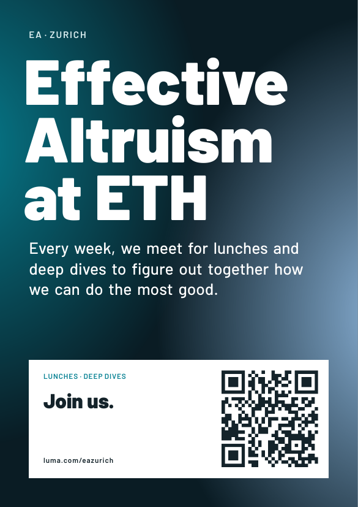

# ea-material

A3 posters for EA at ETH, Zurich AI Safety (ZAIS) and the Zurich Biosecurity Hub. Click a preview to open the PDF.

| EA at ETH | Zurich AI Safety | Zurich Biosecurity Hub |
| :-: | :-: | :-: |
| [](pdf/ea.pdf) | [](pdf/zais.pdf) | [](pdf/bio.pdf) |

## Building

Requires LuaLaTeX and latexmk.

```sh
make            # build pdf/*.pdf
make previews   # also render previews/*.png
```

## IBIS screen ads

The UZH [IBIS screens](https://www.kommunikation.uzh.ch/en/services/ibis.html) show full-screen
16:9 ads (1920 × 1080 px, JPG or PNG) for 15 seconds. `scripts/ibis.py` makes one from a Luma event link:

```sh
make ibis URL=https://luma.com/abcd1234          # brand picked from the event's Luma calendar
make ibis URL=https://luma.com/abcd1234 ORG=bio  # force ea, zais or bio
scripts/ibis.py https://luma.com/abcd1234 --title "Shorter title" --blurb "One-line pitch."
```

It reads the title, date, time, place and description from the event page, renders
`screens/ibis.tex` in the brand of EA Zurich (`eazurich`), ZAIS (`zais`) or the Zurich
Biosecurity Hub (`zurich-biosecurity-hub`), and writes `ibis/<date>-<slug>.png` with a QR
code to the event. The blurb is the first real paragraph of the description, cut to about
170 characters; if the text runs into the date, the title shrinks and then the blurb is dropped.
Check the PNG before submitting: override `--title`, `--blurb` or `--where` if needed
(Luma hides some addresses until people register, so the place may fall back to the city).
Needs `qrencode` in addition to the LaTeX tools.
